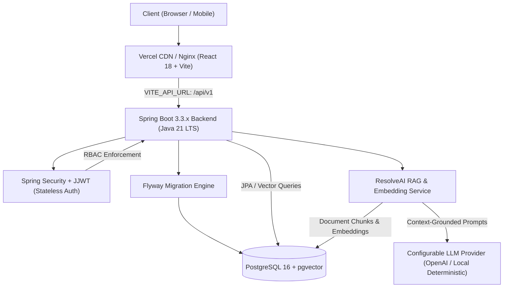
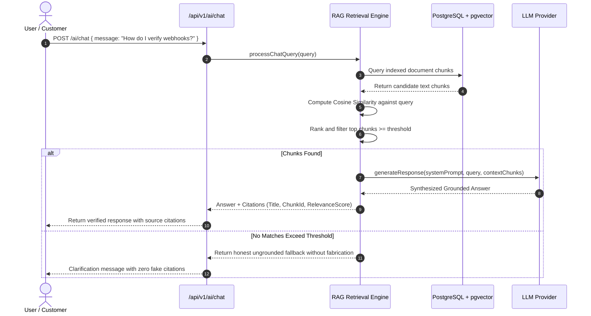

# ResolveAI System Architecture Specification

## 1. Executive Summary

**ResolveAI** is an enterprise-grade AI customer support SaaS platform built to unify ticket workflow operations with high-fidelity, grounded Retrieval-Augmented Generation (RAG). The system is architected for strict factual truthfulness: every response generated by the AI Copilot is grounded in internal knowledge base documents with verifiable citations and cosine similarity confidence scores.

---

## 2. High-Level Architecture Diagram

---

## 3. Frontend Architecture

- **Framework:** React 18 with TypeScript 5 and Vite 5.
- **Styling System:** Tailwind CSS with custom Dark Navy theme (`#060913`, `#0B0F19`, `#151E32`) and violet/indigo accents (`#6366F1`, `#8B5CF6`).
- **Icons & Visuals:** `lucide-react` for responsive, lightweight SVG icons.
- **API Client:** Centralized `ApiClient` class in `src/api.ts` configured via `VITE_API_URL` environment variable. Features automated JWT bearer authorization header insertion, response status error deserialization, and token refresh/cleanup.
- **User Interface Modules:**
  - **Landing Page:** Interactive product teaser, real-time RAG simulation preview, pricing tiers, feature showcase.
  - **Authentication:** Dedicated login and registration screens with role assignment (`CUSTOMER`, `AGENT`, `ADMIN`) and pre-seeded quick demo buttons.
  - **Dashboard:** Real-time KPI metric cards (Total Tickets, Open Tickets, Urgent Tickets, AI Deflection Rate), recent activity queue, and quick-action modals.
  - **Ticketing Queue:** Multi-attribute filtering (Status, Priority, Search), live SLA badges, and ticket detail conversation view.
  - **AI Support Copilot:** Interactive conversational interface with source document citations, similarity match percentages, model indicators, and copy-to-clipboard.
  - **Knowledge Base Manager:** Drag-and-drop document uploader (.txt, .md, .pdf), ingestion status badges, and interactive vector chunk inspection modal.
  - **Analytics & SLA:** Real aggregate charts for status breakdown, priority distribution, resolution time averages, and CSAT scores.
  - **Team Directory:** Role management interface for administrator oversight.
  - **Platform Settings:** Real-time backend telemetry, PostgreSQL connection state, vector engine indicators, and environment details.

---

## 4. Backend Architecture

- **Runtime & Language:** Java 21 LTS (OpenJDK 21).
- **Application Framework:** Spring Boot 3.3.x with Spring Data JPA and Spring Security 6.
- **Authentication & RBAC:**
  - Stateless JSON Web Tokens (JJWT 0.12.x) with HMAC-SHA256 signing.
  - Password hashing utilizing BCrypt with cost factor 10.
  - Three distinct roles:
    - `CUSTOMER`: Can create support tickets, view personal tickets, and receive public agent responses.
    - `AGENT`: Can triage all organizational tickets, claim assignments, update priorities/statuses, and record internal staff notes.
    - `ADMIN`: Full organizational privileges including role modification, knowledge document ingestion, and AI credentials configuration.
- **Centralized Exception Safety:**
  - `GlobalExceptionHandler` intercepting `ResourceNotFoundException`, `BadRequestException`, `BadCredentialsException`, `AccessDeniedException`, and validation errors, emitting standardized `ApiErrorResponse` envelopes.

---

## 5. RAG Pipeline & Vector Search Engine

### Document Ingestion & Chunking
1. **Validation:** Uploaded documents are constrained to a maximum of 10MB in format `.txt`, `.md`, `.pdf`, `.csv`, or `.json`.
2. **Sliding Window Chunking:** Raw documents are segmented into ~600-character windows with a 100-character sliding overlap. Chunk breaks respect punctuation boundaries (`.`, `?`, `!`, `\n`) to prevent mid-sentence fragmentation.
3. **Vector Embeddings:** Each chunk is mapped to a vector embedding stored in the `document_chunks` table.
4. **Retrieval & Grounding:** User inquiries are evaluated across indexed chunks using Cosine Similarity (`dot(A, B) / (norm(A) * norm(B))`). Matches exceeding the similarity threshold are assembled as grounding context for the synthesis engine.
5. **Hallucination Prevention:** The system is explicitly configured never to fabricate citations or claim an unconfigured AI provider is working.

---

## 6. Database Schema & Flyway Migrations

The database lifecycle is managed via Flyway:
- `V1__init_schema.sql`:
  - `users`: Primary key `id` (UUID), `name`, `email` (unique index), `password_hash`, `role`, `created_at`, `updated_at`.
  - `tickets`: Primary key `id` (UUID), `title`, `description`, `status`, `priority`, `category`, foreign key `customer_id`, foreign key `assigned_to_id`, indexes on `status`, `priority`, `customer_id`.
  - `ticket_comments`: Primary key `id`, foreign key `ticket_id`, foreign key `author_id`, `content`, `is_internal`, `created_at`.
  - Pre-seeded users (`admin@resolveai.io`, `agent@resolveai.io`, `customer@resolveai.io`) and initial triage tickets.
- `V2__rag_knowledge_base.sql`:
  - `knowledge_documents`: Primary key `id`, `title`, `file_name`, `file_size`, `content_type`, `status`, `chunk_count`.
  - `document_chunks`: Primary key `id`, foreign key `document_id`, `chunk_index`, `content`, `embedding_vector`.
  - Pre-seeded documentation on Webhook Integration & SLA Policies with pre-computed vector chunks.
